# Huertos Urbanos: Parcelas

Práctica de microservicios con Spring Boot: registro y consulta de parcelas con **validación**, **sanitización** y **manejo de errores con excepciones y mensajes personalizados**.

## Arquitectura

```
Postman → parcel-composite-service (8080) → parcel-service (8081) → MongoDB
```

| Servicio | Puerto | Función |
|---|---|---|
| `parcel-service` (base) | 8081 | CRUD de parcelas, validación, sanitización y errores |
| `parcel-composite-service` (compose) | 8080 | Consulta al servicio base y devuelve la parcela con su estado actual |

**Stack:** Java 21, Spring Boot 4.1.1, Spring Web, Spring Data MongoDB, Spring Validation, Maven.

## Cómo ejecutar

Requisitos: Java 17+ y MongoDB en `localhost:27017`. Abre dos terminales:

```powershell
cd parcel-service
.\mvnw spring-boot:run
```

```powershell
cd parcel-composite-service
.\mvnw spring-boot:run
```

## Endpoints

**Servicio base (8081)**

| Método | Ruta | Respuestas |
|---|---|---|
| POST | `/api/v1/parcels` | 201, 400, 409 |
| GET | `/api/v1/parcels` | 200 |
| GET | `/api/v1/parcels/{id}` | 200, 400, 404 |

**Servicio compose (8080)**

| Método | Ruta | Respuestas |
|---|---|---|
| GET | `/api/v1/parcels/{id}` | 200, 400, 404, 503 |

Ejemplo de body para POST:

```json
{
  "name": "Huerto Norte",
  "location": { "latitude": 28.63, "longitude": -106.07 },
  "soilType": "arcilloso",
  "ownerOrLead": "Ana López"
}
```

## Validación, sanitización y errores

- **Validación:** anotaciones `@NotBlank`, `@Size`, `@Pattern`, `@DecimalMin/@DecimalMax`, `@NotNull` y `@Valid` en `ParcelRequest`; el `id` se valida con `@Pattern` (24 caracteres hexadecimales).
- **Sanitización:** `InputSanitizer` elimina scripts, etiquetas HTML, caracteres de control y caracteres peligrosos antes de guardar. Ejemplo: `<b>Huerto</b> Sur<script>alert(1)</script>` se guarda como `Huerto Sur`.
- **Excepciones personalizadas:**

| Excepción | HTTP | Servicio |
|---|---|---|
| `InvalidInputException` | 400 | base |
| `ResourceNotFoundException` | 404 | base y compose |
| `DuplicateResourceException` | 409 | base |
| `ServiceUnavailableException` | 503 | compose |

- **Mensajes de error:** un `GlobalExceptionHandler` devuelve siempre el mismo formato:

```json
{
  "timestamp": "2026-10-14T22:10:00Z",
  "status": 400,
  "error": "Bad Request",
  "message": "Los datos enviados no son válidos",
  "path": "/api/v1/parcels",
  "details": ["name: El nombre de la parcela es obligatorio"]
}
```

## Evidencias (carpeta `docs/`)

### Servicio base (8081)

| # | Prueba | Resultado |
|---|---|---|
| 1 | Registro correcto | 201 |
| 2 | Validación fallida | 400 |
| 3 | Sanitización | 201 |
| 4 | Campo vacío tras sanitizar | 400 |
| 5 | Nombre duplicado | 409 |
| 6 | Listar parcelas | 200 |
| 7 | ID inválido | 400 |
| 8 | Parcela no encontrada | 404 |
| 9 | JSON mal formado | 400 |

**1. Registro correcto (201)**
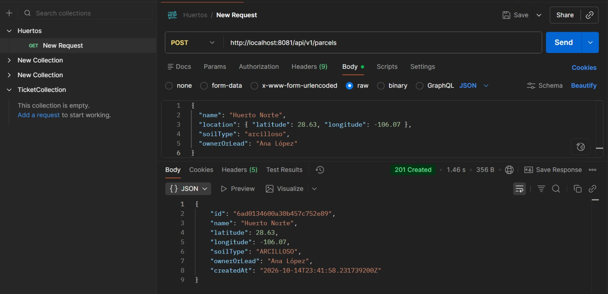

**2. Validación fallida (400)**
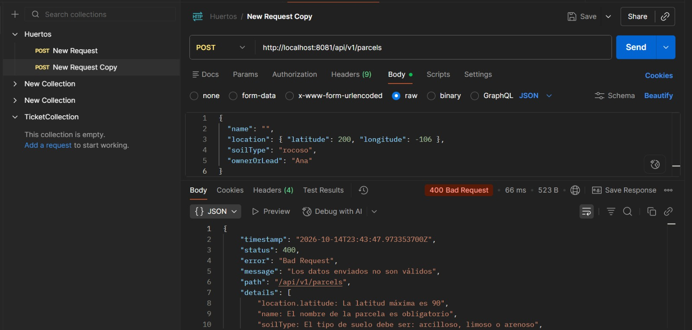

**3. Sanitización (201)**
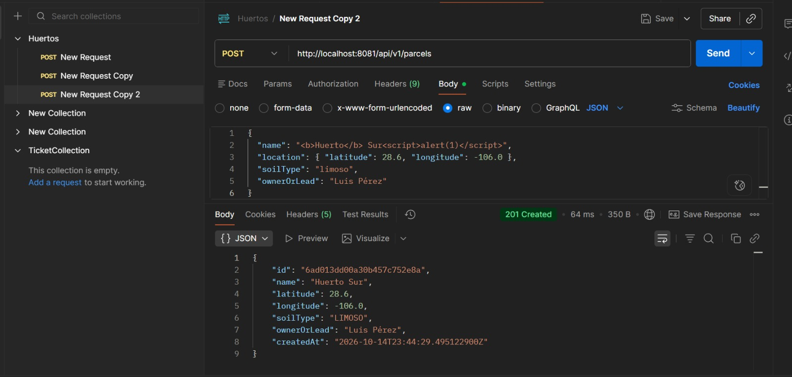

**4. Campo vacío tras sanitizar (400)**
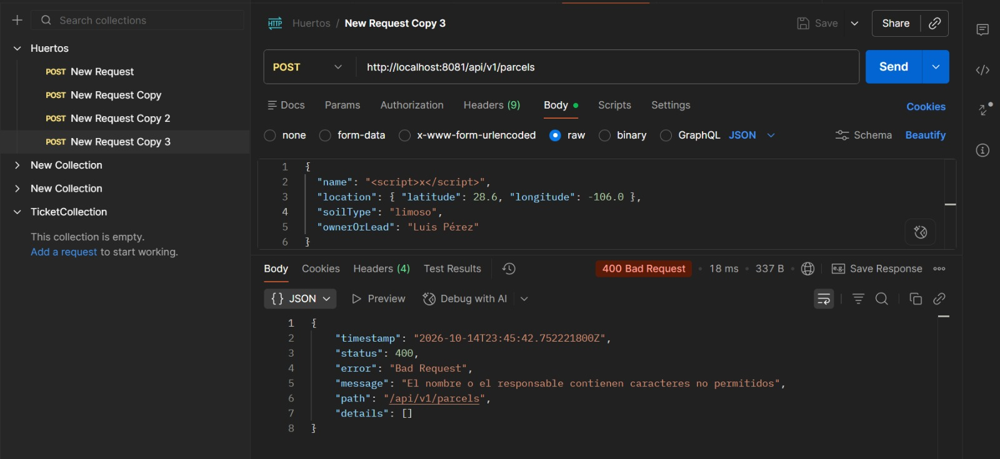

**5. Nombre duplicado (409)**
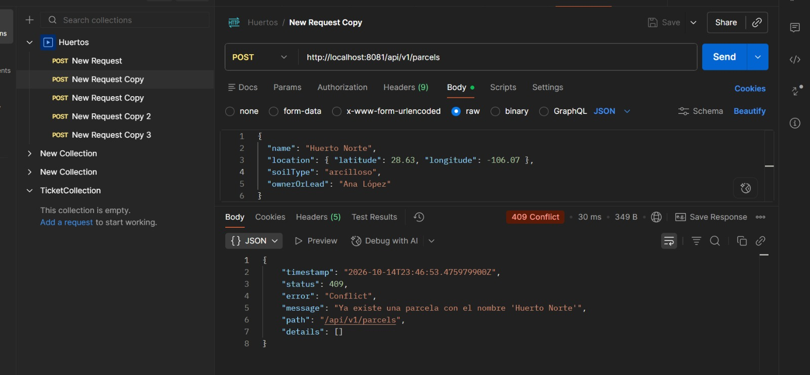

**6. Listar parcelas (200)**
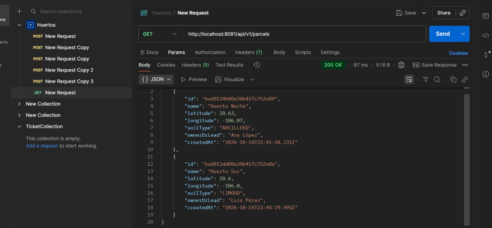

**7. ID inválido (400)**
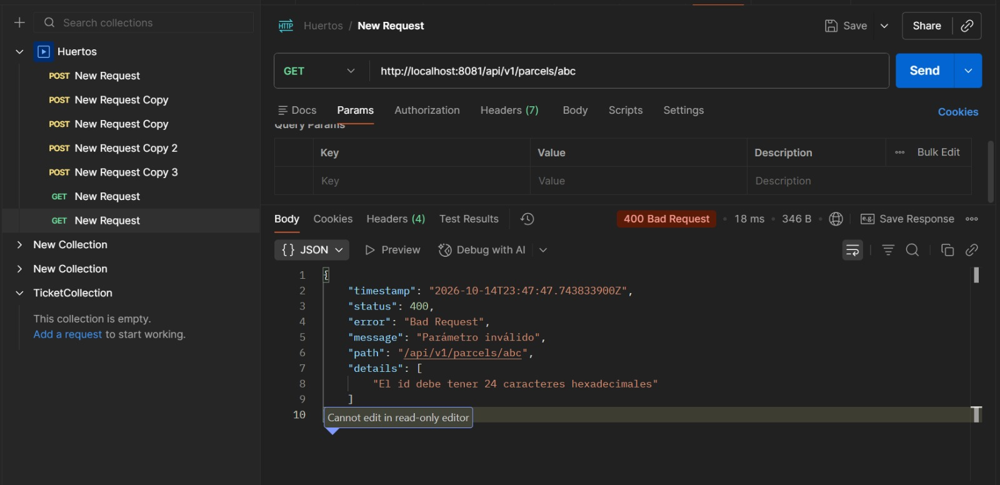

**8. Parcela no encontrada (404)**
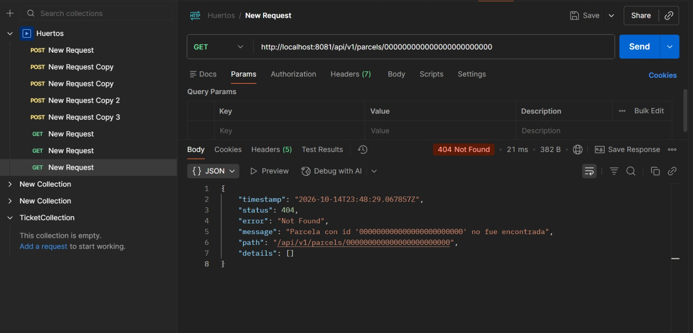

**9. JSON mal formado (400)**
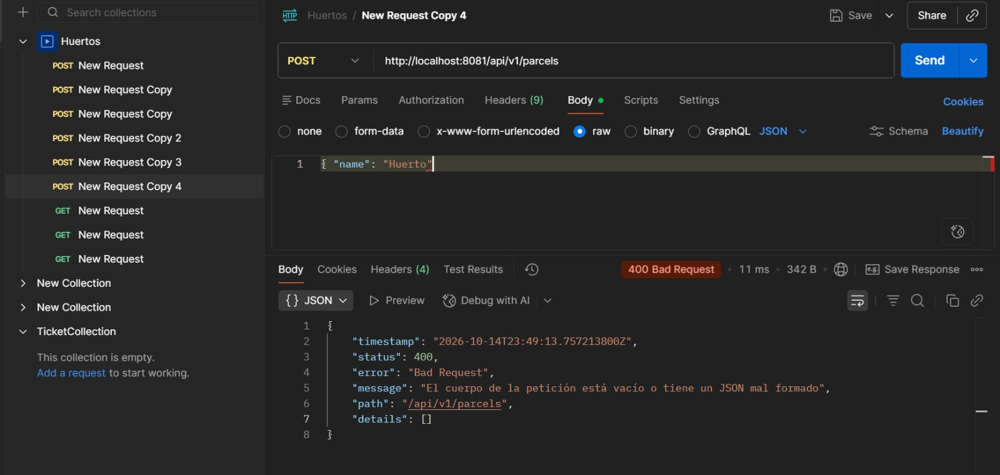

### Servicio compose (8080)

**10. Detalle correcto (200)**
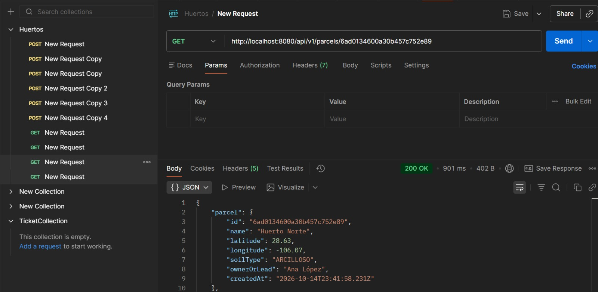

**11. ID inválido (400)**
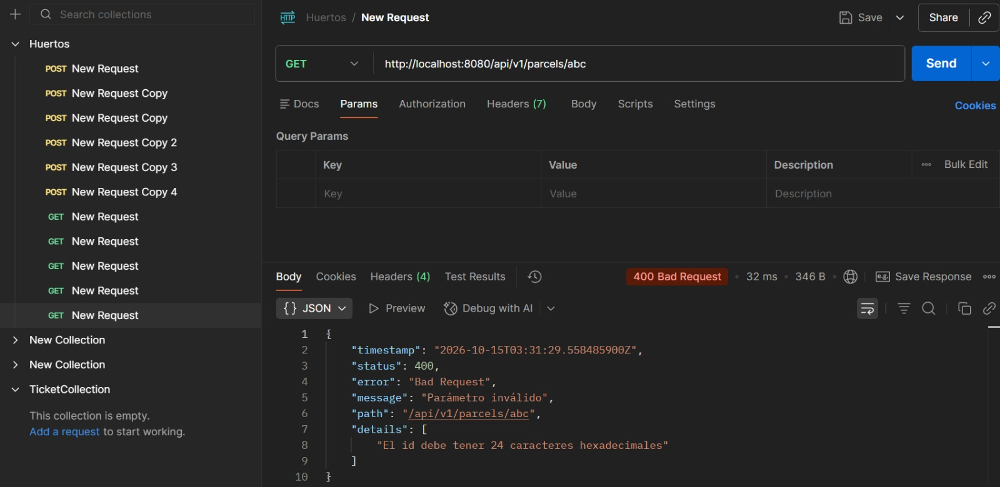

**12. Parcela no encontrada (404)**
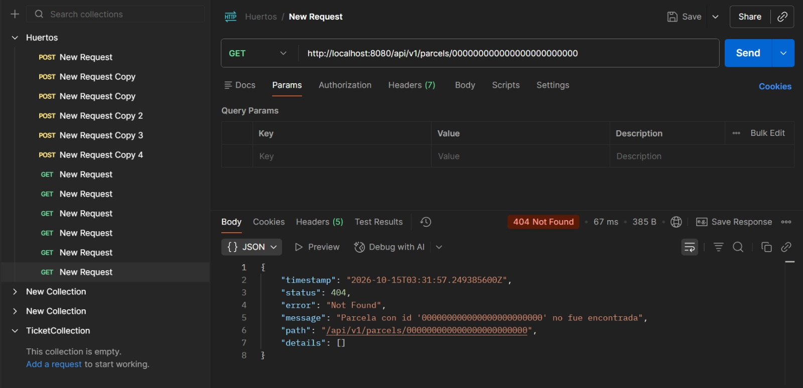

**13. Servicio base caído (503)**
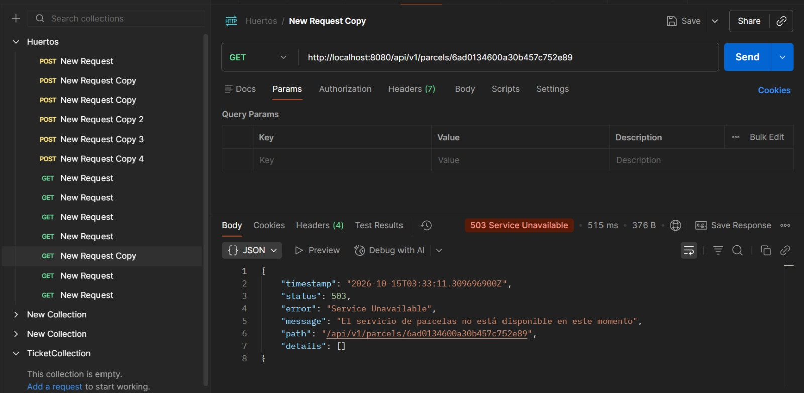

### Compilación y ejecución

**14. Compilación de `parcel-service` (BUILD SUCCESS)**
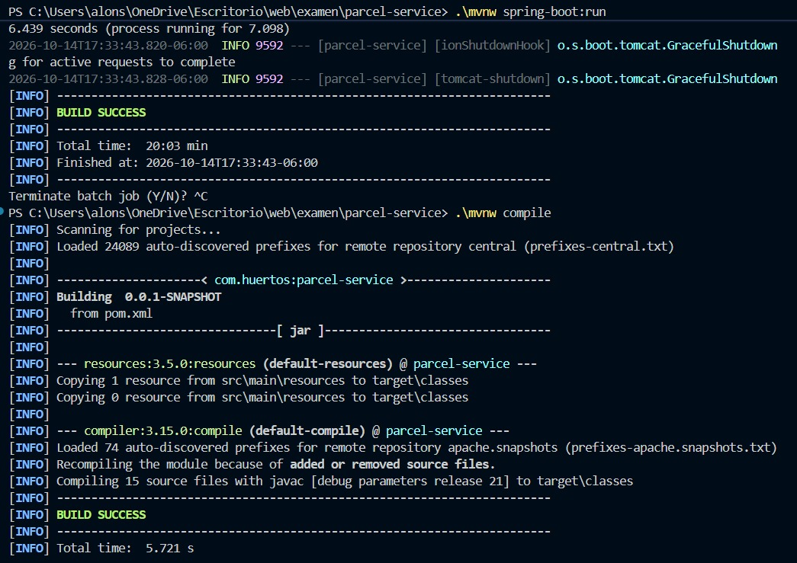

**15. `parcel-service` en ejecución**
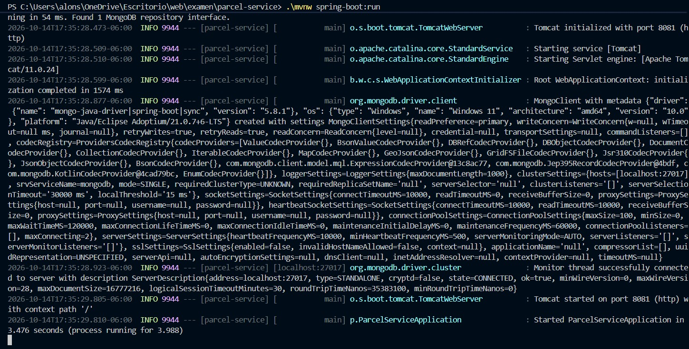

**16. Compilación de `parcel-composite-service` (BUILD SUCCESS)**
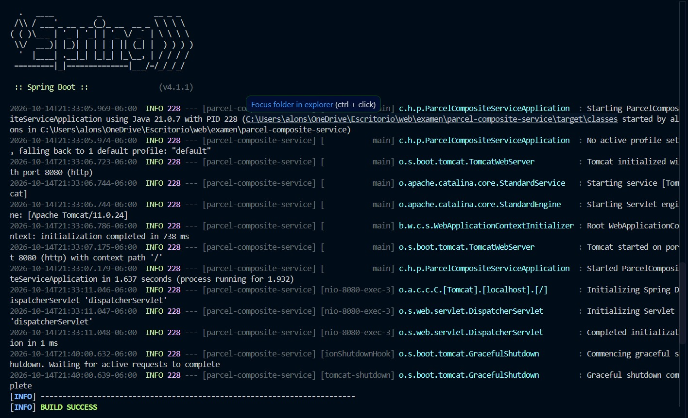

**17. Servicios en ejecución**
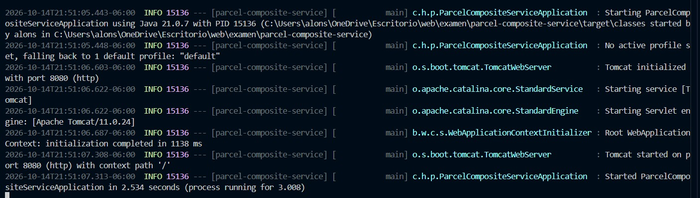

